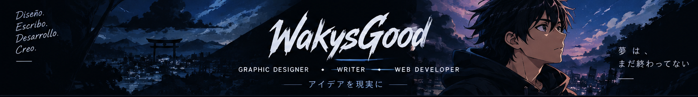

### `hawkyss` — Diseñador gráfico · Escritor · Desarrollador web

**Diseño ideas. Escribo historias. Construyo experiencias digitales.**

---

## `whoami.exe` 🌓

Soy **hawkyss**, un creativo multidisciplinario al que le gusta combinar lo visual, las palabras y la tecnología para convertir ideas en proyectos con personalidad.

- 🎨 **Diseño gráfico:** identidad visual, composición y conceptos creativos.
- ✍️ **Escritura:** historias, ideas y palabras que transmiten algo.
- 💻 **Desarrollo web:** experiencias digitales cuidadas, funcionales y atractivas.
- 🌌 **Inspiración:** anime, estética oscura, música y mundos llenos de imaginación.

> *Cada píxel cuenta una historia. Cada línea construye un mundo.*

## `creative_universe` ✦

| Área | Mi enfoque |
| --- | --- |
| 🎨 Diseño | Darle forma visual a las ideas. |
| ✍️ Escritura | Crear historias, conceptos y emociones. |
| 💻 Web | Convertir ideas en experiencias digitales. |

## `toolkit` ⚙️

<!-- Edita esta sección para reflejar las tecnologías y herramientas que realmente utilizas. -->

## `github_stats` 📈

## `find_me` 🌐

- **GitHub:** [@WakysGood](https://github.com/WakysGood)
- **Portafolio:** [hdevportafolio.netlify.app](https://hdevportafolio.netlify.app/)
- **Instagram:** [@hwk.tzk](https://www.instagram.com/hwk.tzk/)
- **Facebook:** [Mi perfil](https://www.facebook.com/share/1DomSYsiSz/)

---

### `DESIGN • WRITE • BUILD • REPEAT`

*まだ終わっていない — La historia aún no termina.*

**Hecho con creatividad por hawkyss / WakysGood** 🪽

